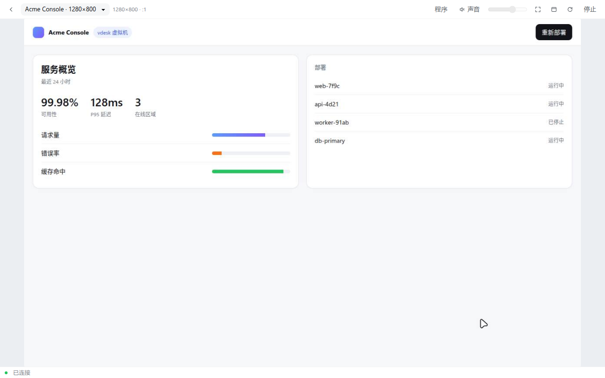
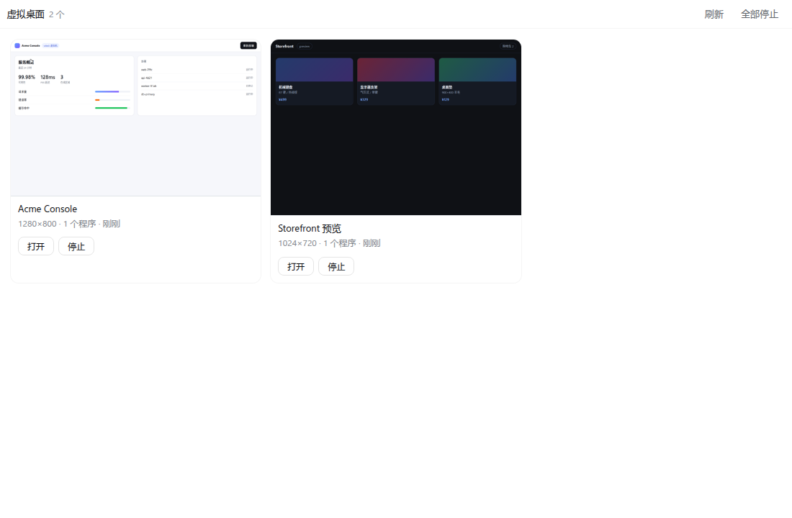
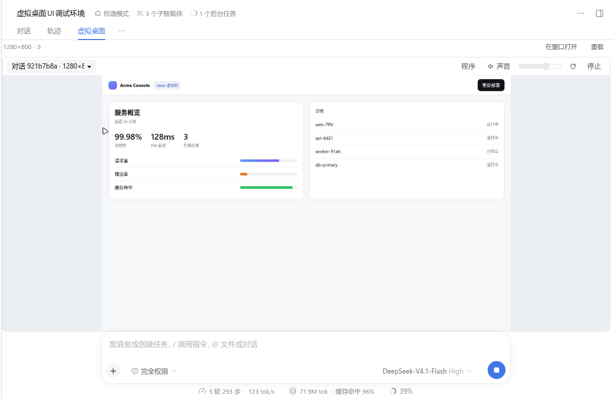

# dsh-wayland-vdesk

**A private Wayland desktop for every DeepSeek Harness conversation.** Run, screenshot, drive and watch GUI
programs off-screen — the windows never touch your real compositor.

[](#license)
[](#requirements)
[](https://github.com/deepseek-ai/deepseek-harness)
[](#requirements)
[](#contributing)

English · [中文](README.zh.md)



A DeepSeek Harness bundle that gives each conversation its own headless **sway** compositor (Wayland + Xwayland),
streams it into the Web UI over VNC, and exposes it to the agent as ordinary tools:

```text
vdesk_create()                                   → open this conversation's desktop
vdesk_run({command: "npm run dev"})              → start a program inside it
vdesk_shot()                                     → PNG straight into the model context
vdesk_input({actions: [{type: "click", x, y}]})  → click / drag / type / press keys
vdesk_apps() / vdesk_kill({pid})                 → see and stop what is running
vdesk_resize({width, height})                    → change the resolution live
```

## Why

An agent that can look at pixels is a much better UI engineer — but pointing a real screen-driver at your desktop is
unpleasant: windows steal focus, pop up over your work, and global input injection (`ydotool`, `/dev/uinput`) hits
whatever session is focused, including yours.

`dsh-wayland-vdesk` gives every conversation a **private compositor** instead:

- **Off-screen by construction.** Its own `XDG_RUNTIME_DIR`, its own `WAYLAND_DISPLAY`, its own Xwayland display.
  `hyprctl clients` never shows a thing.
- **Wayland native *and* X11.** sway's Xwayland runs side by side, so GTK 4, Qt, Electron and Wine all work.
- **Safe input.** Keyboard goes through the compositor's virtual-keyboard protocol, the pointer through sway's own
  seat — never through `/dev/uinput`. The two never meet.
- **Live and two-way.** You watch the same framebuffer the agent screenshots, and you can take over with your own
  mouse and keyboard at any moment.

## Screenshots

| Overview of every conversation's desktop | Embedded in a DSH conversation |
| --- | --- |
|  |  |

The overview lives in the sidebar (live thumbnails, open/stop, stop-all). The per-conversation tab shows one
desktop full-size; the **程序** popover lists the programs and windows inside it and lets you stop them one by one.

## Features

| | |
| --- | --- |
| **Per-conversation isolation** | One sway instance per DSH session, keyed by conversation id. |
| **Any resolution** | Pick it at creation, change it any time (`vdesk_resize`, 320–7680 px). |
| **Wayland + X11** | Xwayland is started inside the desktop; both are captured and injected the same way. |
| **Live view** | noVNC over WebSocket, served from one loopback port, embedded in the DSH Web UI. |
| **Screenshots to the model** | `vdesk_shot` stores a PNG in DSH's attachment store and returns an image block. |
| **Audio** | Each desktop gets its own null sink; PCM is streamed to the page and played through a `GainNode`. Muted until you click 🔊. |
| **Program control** | List and kill the programs and windows a desktop owns — from the UI or from tools. |
| **CLI** | The same daemon is reachable from a shell: `dsh-vdesk run`, `shot`, `env`, `exec`, … |
| **GPU when available** | sway renders through the DRM render node; falls back to software automatically. |

## Requirements

Linux with a Wayland or X11 session and PipeWire/PulseAudio.

```bash
# Arch
sudo pacman -S sway wayvnc grim wtype wl-clipboard novnc

# Debian/Ubuntu (noVNC is packaged as novnc + python3-websockify)
sudo apt install sway wayvnc grim wtype wl-clipboard novnc
```

| Program | Why |
| --- | --- |
| `sway` | the headless compositor (Wayland + Xwayland) |
| `wayvnc` | exposes the framebuffer/input over RFB on loopback |
| `grim` | screenshots |
| `wtype` | keyboard injection through the virtual-keyboard protocol |
| `wl-clipboard` | paste-based input for CJK and long text (optional) |
| `wlrctl` | relative pointer motion, needed for mouse-look and games (optional) |
| noVNC | the browser-side RFB client (any `core/rfb.js` tree; `DSH_VDESK_NOVNC` overrides the path) |

`ffmpeg` is used to downscale screenshots, `xdotool` is optional. Node ≥ 22.

## Install

1. **Install the bundle.** Open **Settings → Plugins → Install bundle** and point it at this repository, or from a
   checkout:

   ```bash
   dsh plugin --profile web add /path/to/dsh-wayland-vdesk
   ```

   then add `dsh-wayland-vdesk` to `dsh.profile.bundles` in the profile's `package.json`. The Plugin manager does both
   steps for you, so prefer it.

2. **Reload the DSH Web UI.** A **虚拟桌面** entry appears in the sidebar, and every conversation gains a
   **虚拟桌面** view tab.

3. **Check the daemon:**

   ```bash
   dsh-vdesk status
   ```

   It reports the hub port, which capabilities were found, and the current desktops.

## Using it

### From the Web UI

- **Sidebar → 虚拟桌面** — the overview: every desktop with a live thumbnail, `打开` / `停止`, and `全部停止`.
- **Conversation → 虚拟桌面 tab** — this conversation's desktop, full size.
  - **程序** — programs and windows inside the desktop; ✕ kills a program or closes a window.
  - **停止** — tears the desktop down.
  - 🔊 — audio, muted by default; the slider next to it sets the gain.
  - **鼠标** — capture the mouse for games: moves become relative `look` steps instead of absolute
    warps (Esc releases). Absolute pointer events cannot drive a pointer-locked client.

### From an agent

```text
vdesk_create({width: 1440, height: 900})
vdesk_run({command: "python -m http.server 5173", wait: false})
vdesk_run({command: "chromium --app=http://localhost:5173"})
vdesk_run({command: "sleep 4", wait: true})
vdesk_shot()
vdesk_input({actions: [{type: "click", x: 320, y: 180}]})
vdesk_input({actions: [{type: "type", text: "hello"}]})
vdesk_shot()
```

Full parameter reference: [docs/tools.md](docs/tools.md).

### From a shell

```bash
dsh-vdesk create --conv my-app --size 1440x900
dsh-vdesk run  my-app -- cargo run
dsh-vdesk shot my-app --out /tmp/shot.png
dsh-vdesk env  my-app            # export lines you can eval into your shell
dsh-vdesk click my-app 640 400 && dsh-vdesk type my-app "hello"
```

Full command reference: [docs/cli.md](docs/cli.md).

## How it works

```text
DSH Web (127.0.0.1:3080)
 └── conversation view / overview panel
        │ iframe
        ▼
   dsh-vdesk hub (127.0.0.1:7317, token-guarded)
        ├── /            viewer page        ├── /overview   overview page
        ├── /vnc/<id>    RFB over WebSocket ├── /audio/<id> PCM over WebSocket
        └── /api/*       JSON API
        │
        ▼
   dsh-vdesk daemon (one long-lived Node process)
        └── session s-xxxx  (one per conversation)
              ├── sway  (WLR_BACKENDS=headless, private XDG_RUNTIME_DIR)
              │     ├── wayland-1
              │     └── Xwayland :N
              ├── wayvnc → 127.0.0.1:<random port>
              ├── null sink dsh_vdesk_<id> + parec (on demand)
              └── the programs you started
```

The daemon is deliberately **outside** the DSH process: the CLI and the tools share one state, and a DSH restart or a
plugin reload cannot orphan a compositor. Details and the reasoning behind each choice: [docs/architecture.md](docs/architecture.md).

## Security model

- The hub binds **127.0.0.1** only, and every URL carries a per-daemon random token; the API and both WebSockets
  reject requests without it. Cross-origin pages cannot read the iframe URL, so they cannot obtain the token.
- Input never leaves the desktop: no `/dev/uinput`, no synthetic events into your session.
- This is **display isolation, not a sandbox** — programs run as you, with your files. Run untrusted code in a
  container or VM.

## Limitations

- **Linux only** (Wayland compositor + PipeWire/PulseAudio).
- **No IME inside the desktop.** Use `method: "paste"` for CJK or long text; `wtype` types Latin text directly.
- If DSH is served over **HTTPS**, browsers block the `http://` viewer iframe as mixed content.
- One noVNC view per desktop is fine; many simultaneous viewers are not a design goal.
- Software rendering is used when the compositor cannot get a DRM render node.

## FAQ

**Does this show anything on my real desktop?** No. The desktop is a separate headless sway instance with its own
runtime dir; nothing is ever mapped onto your session.

**Can the agent and I use it at the same time?** Yes. The agent's `vdesk_input` goes through the compositor's seat and
your browser's input goes through wayvnc's virtual devices — both land in the same desktop.

**Where does audio go?** Into a per-desktop null sink. Nothing reaches your speakers unless you unmute the viewer;
the gain is applied in the browser, so your system volume is untouched.

**How do I stop everything?**

```bash
dsh-vdesk stop-hub      # daemon + all desktops
```

## Repository layout

```
index.js              Host half: tools + authenticated routes      web/          viewer + overview pages
client.js             Client half: sidebar entry, panel, view tab   src/          daemon, sessions, audio, hub, CLI
cordis.patch.yml      bundle patch (one row)                        docs/         tool, CLI, architecture docs
locale/{en,zh}.json   Plugin Manager metadata                       docs/images/  screenshots
```

## Contributing

Issues and pull requests are welcome. The repository uses [Conventional Commits](https://www.conventionalcommits.org/)
and signed commits.

```bash
node --check index.js && node --check client.js && node --check src/cli.js
dsh-vdesk status
```

## License

[MIT](LICENSE)
