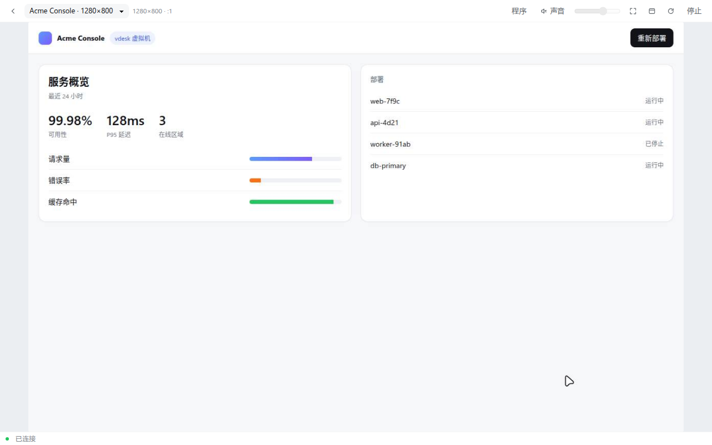
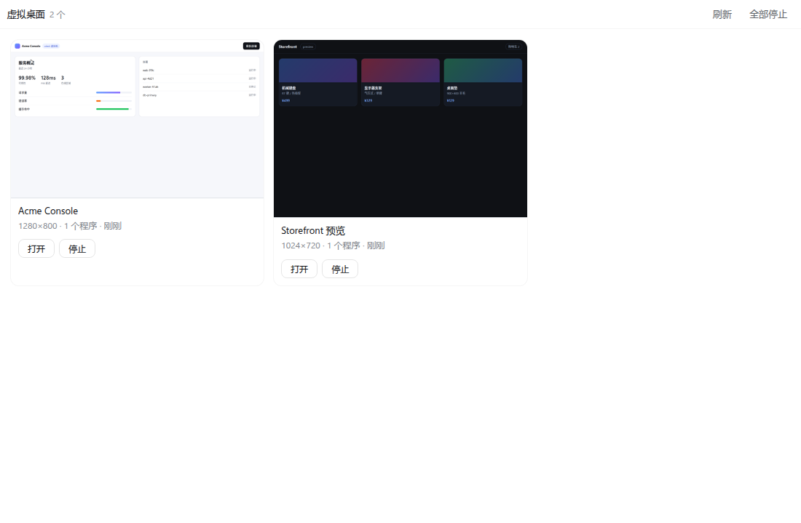
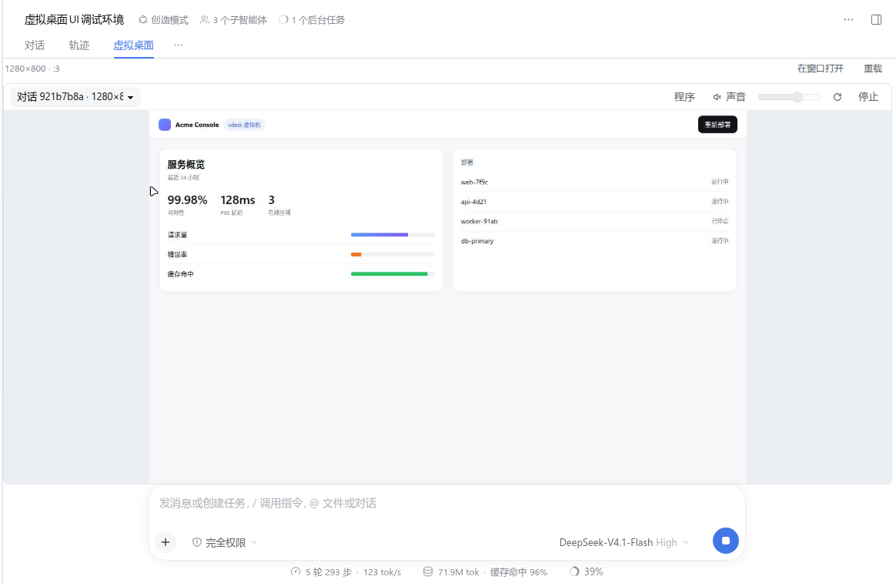

# dsh-wayland-vdesk

**给每个 DeepSeek Harness 对话一块私有的 Wayland 桌面。** 在离屏的合成器里运行、截图、操作和观看 GUI 程序——
窗口永远碰不到你真实的桌面。

[](#许可证)
[](#环境要求)
[](https://github.com/deepseek-ai/deepseek-harness)
[](#环境要求)

[English](README.md) · 中文



它是一个 DeepSeek Harness 插件：给每个对话分配一个独立的 **headless sway**（Wayland + Xwayland），
通过 VNC 把画面接进 Web UI，同时把这块桌面变成 agent 可以直接调用的工具：

```text
vdesk_create()                                   → 打开本对话的桌面
vdesk_run({command: "npm run dev"})              → 在里面启动程序
vdesk_shot()                                     → PNG 直接进模型上下文
vdesk_input({actions: [{type: "click", x, y}]})  → 点击 / 拖拽 / 输入 / 组合键
vdesk_apps() / vdesk_kill({pid})                 → 查看并结束里面的程序
vdesk_resize({width, height})                    → 实时改分辨率
```

## 为什么

能"看见像素"的 agent 是更好的 UI 工程师，但把真实屏幕交给它很难受：窗口抢焦点、盖住你的工作，
而全局输入注入（`ydotool`、`/dev/uinput`）会打到当前聚焦的会话——也就是你自己的桌面。

这个项目换了个思路，给每个对话一块**私有合成器**：

- **天生离屏**：独立的 `XDG_RUNTIME_DIR`、独立的 `WAYLAND_DISPLAY`、独立的 Xwayland display，
  `hyprctl clients` 永远看不到里面的窗口。
- **Wayland 原生 + X11**：sway 里同时跑着 Xwayland，GTK 4、Qt、Electron、Wine 都能用。
- **输入不外溢**：键盘走合成器的虚拟键盘协议，指针走 sway 自己的 seat——完全不经过 `/dev/uinput`。
- **双向可见**：你看的就是 agent 截到的同一块 framebuffer，随时可以用自己的鼠标键盘接管。

## 截图

| 所有对话的桌面总览 | 嵌在 DSH 对话里 |
| --- | --- |
|  |  |

总览在侧边栏，带实时缩略图、打开/停止、全部停止；对话里的页签显示单个桌面，右上角 **程序** 弹层可以逐个结束
程序或关闭窗口。

## 功能

| | |
| --- | --- |
| **每对话隔离** | 每个 DSH session 一个 sway 实例，按 conversation id 绑定。 |
| **任意分辨率** | 创建时指定，随时 `vdesk_resize`（320–7680 px）。 |
| **Wayland + X11** | Xwayland 跑在桌面内部，两种程序走同一套截屏与注入路径。 |
| **实时画面** | noVNC over WebSocket，单个 loopback 端口，直接嵌在 DSH Web UI 里。 |
| **截图进上下文** | `vdesk_shot` 把 PNG 存进 DSH 的 attachment store，返回 image block。 |
| **音频** | 每个桌面一个独立 null sink，PCM 推到页面用 `GainNode` 播放；默认静音，点 🔊 才出声。 |
| **程序管理** | 列出并结束桌面里的程序与窗口——UI 和工具都能做。 |
| **CLI** | 同一个守护进程也能从 shell 用：`dsh-vdesk run`、`shot`、`env`、`exec`… |
| **能用 GPU 就用** | sway 走 DRM render node，拿不到就自动退软件渲染。 |

## 环境要求

Linux，Wayland 或 X11 会话，PipeWire/PulseAudio。

```bash
# Arch
sudo pacman -S sway wayvnc grim wtype wl-clipboard novnc

# Debian/Ubuntu
sudo apt install sway wayvnc grim wtype wl-clipboard novnc
```

| 程序 | 用途 |
| --- | --- |
| `sway` | headless 合成器（Wayland + Xwayland） |
| `wayvnc` | 把画面/输入经 RFB 暴露到 loopback |
| `grim` | 截图 |
| `wtype` | 虚拟键盘注入 |
| `wl-clipboard` | 粘贴式输入，处理中文和长文本（可选） |
| noVNC | 浏览器端 RFB 客户端（任意 `core/rfb.js` 目录，`DSH_VDESK_NOVNC` 可覆盖） |

`ffmpeg` 用于缩放截图，`xdotool` 可选。Node ≥ 22。

## 安装

1. **安装插件**：**设置 → 插件 → 安装插件包**，指向本仓库；或在 checkout 里：

   ```bash
   dsh plugin --profile web add /path/to/dsh-wayland-vdesk
   ```

   然后把 `dsh-wayland-vdesk` 加进 profile `package.json` 的 `dsh.profile.bundles`。
   插件管理器会同时完成这两步，优先用它。

2. **刷新 DSH 网页**：侧边栏出现 **虚拟桌面**，每个对话多一个 **虚拟桌面** 页签。

3. **确认守护进程**：

   ```bash
   dsh-vdesk status
   ```

## 怎么用

### 在网页里

- **侧边栏 → 虚拟桌面**：总览，所有桌面带实时缩略图，可 `打开` / `停止` / `全部停止`。
- **对话 → 虚拟桌面 页签**：当前对话的桌面。
  - **程序**：桌面里的程序和窗口，✕ 结束程序或关闭窗口；
  - **停止**：销毁整个桌面；
  - 🔊：声音（默认静音），旁边滑杆调音量。

### 让 agent 用

```text
vdesk_create({width: 1440, height: 900})
vdesk_run({command: "python -m http.server 5173", wait: false})
vdesk_run({command: "chromium --app=http://localhost:5173"})
vdesk_run({command: "sleep 4", wait: true})
vdesk_shot()
vdesk_input({actions: [{type: "click", x: 320, y: 180}]})
vdesk_input({actions: [{type: "type", text: "你好"}]})
vdesk_shot()
```

完整参数见 [docs/tools.md](docs/tools.md)。

### 在 shell 里

```bash
dsh-vdesk create --conv my-app --size 1440x900
dsh-vdesk run  my-app -- cargo run
dsh-vdesk shot my-app --out /tmp/shot.png
dsh-vdesk env  my-app            # 打印 export 行，可以 eval 进当前 shell
dsh-vdesk click my-app 640 400 && dsh-vdesk type my-app "hello"
```

完整命令见 [docs/cli.md](docs/cli.md)。

## 工作原理

```text
DSH Web (127.0.0.1:3080)
 └── 对话页签 / 总览面板
        │ iframe
        ▼
   dsh-vdesk hub (127.0.0.1:7317, 带 token)
        ├── /            查看器      ├── /overview   总览
        ├── /vnc/<id>    RFB over WS ├── /audio/<id>  PCM over WS
        └── /api/*       JSON API
        │
        ▼
   dsh-vdesk daemon（常驻 Node 进程）
        └── session s-xxxx（每个对话一个）
              ├── sway（WLR_BACKENDS=headless，私有 XDG_RUNTIME_DIR）
              │     ├── wayland-1
              │     └── Xwayland :N
              ├── wayvnc → 127.0.0.1:<随机端口>
              ├── null sink dsh_vdesk_<id> + 按需 parec
              └── 你启动的程序
```

守护进程**刻意放在 DSH 进程之外**：CLI 和工具共享同一份状态，DSH 重启或插件热重载都不会留下孤儿合成器。
每个设计选择的理由见 [docs/architecture.md](docs/architecture.md)。

## 安全模型

- hub 只监听 **127.0.0.1**，所有 URL 都带每次启动随机生成的 token；API 和两个 WebSocket 都会校验。
  跨站页面读不到 iframe 的 URL，也就拿不到 token。
- 输入不会离开桌面：没有 `/dev/uinput`，不会往你的会话里注入事件。
- 这是**显示隔离，不是安全沙箱**——程序以你的身份运行，能读写你的文件。跑不可信代码请用容器或虚拟机。

## 限制

- **仅 Linux**（Wayland 合成器 + PipeWire/PulseAudio）。
- 桌面内**没有输入法**：中文或长文本用 `method: "paste"`；`wtype` 直接打拉丁字符。
- DSH 如果跑在 **HTTPS** 下，浏览器会把 `http://` 的画面 iframe 当混合内容拦掉。
- 一个桌面一个查看器是常态，多人同时看不是设计目标。
- 拿不到 DRM render node 时自动退软件渲染。

## 常见问题

**会在我真实桌面上弹窗吗？** 不会。桌面是独立的 headless sway 实例，有自己的 runtime dir，不会映射到你的会话。

**agent 和我能同时操作吗？** 能。agent 的 `vdesk_input` 走合成器的 seat，浏览器输入走 wayvnc 的虚拟设备，
最终都落进同一块桌面。

**声音去哪了？** 进每个桌面独立的 null sink。除非你点开声音，否则不会到你扬声器；音量在浏览器侧调整，
不动系统音量。

**怎么全部停掉？**

```bash
dsh-vdesk stop-hub      # 守护进程 + 所有桌面
```

## 仓库结构

```
index.js              Host 半：工具 + 鉴权路由          web/          查看器与总览页面
client.js             Client 半：侧边栏、面板、对话页签   src/          daemon、会话、音频、hub、CLI
cordis.patch.yml      插件包 patch（一行）                docs/         工具/CLI/架构文档
locale/{en,zh}.json   插件管理器元数据                    docs/images/  截图
```

## 参与贡献

欢迎 issue 和 PR。仓库使用 [Conventional Commits](https://www.conventionalcommits.org/) 和签名提交。

```bash
node --check index.js && node --check client.js && node --check src/cli.js
dsh-vdesk status
```

## 许可证

[MIT](LICENSE)
